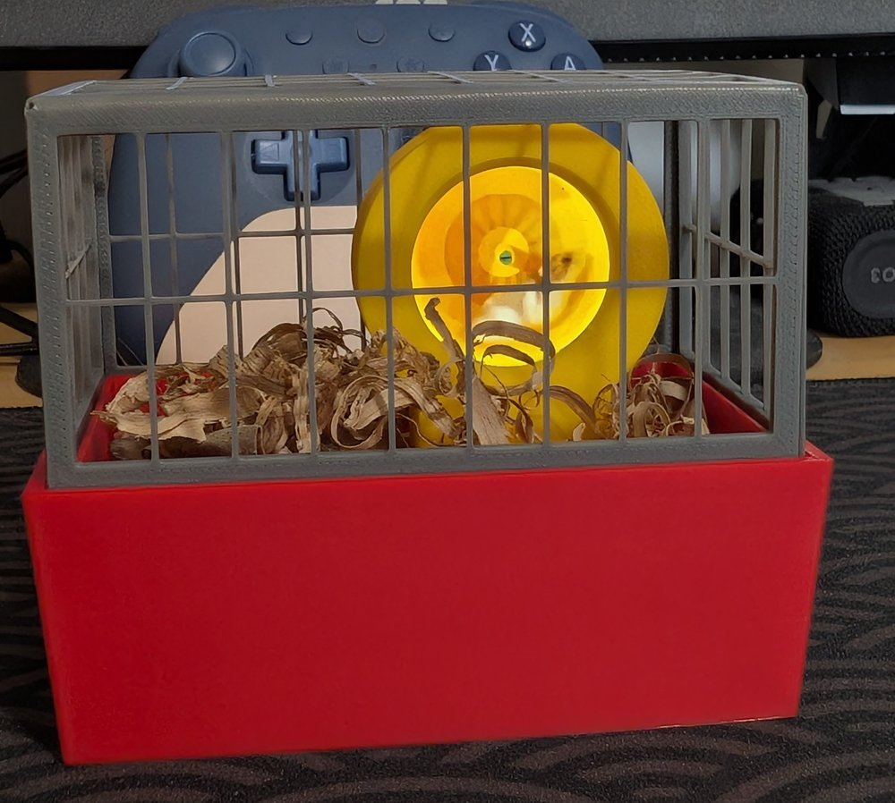
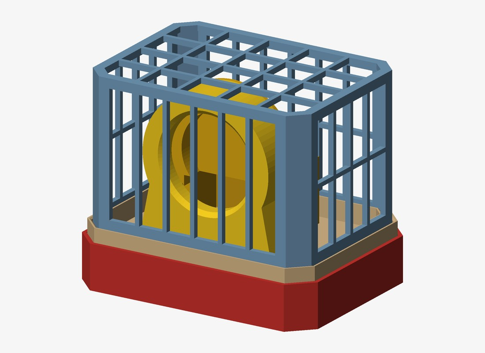
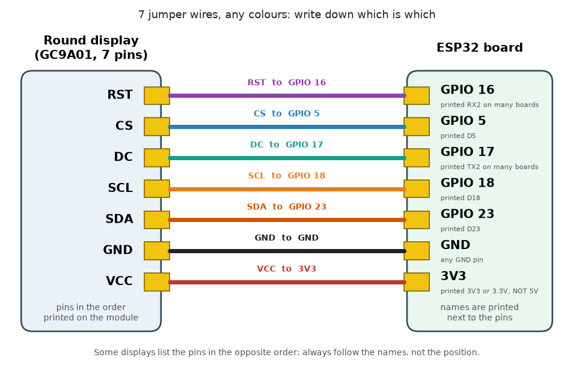
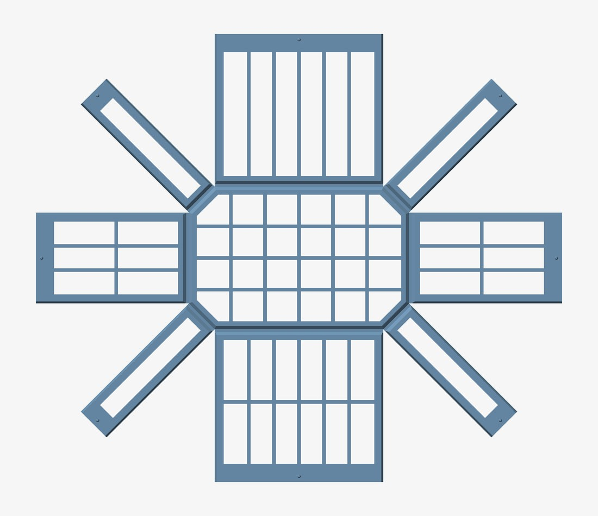
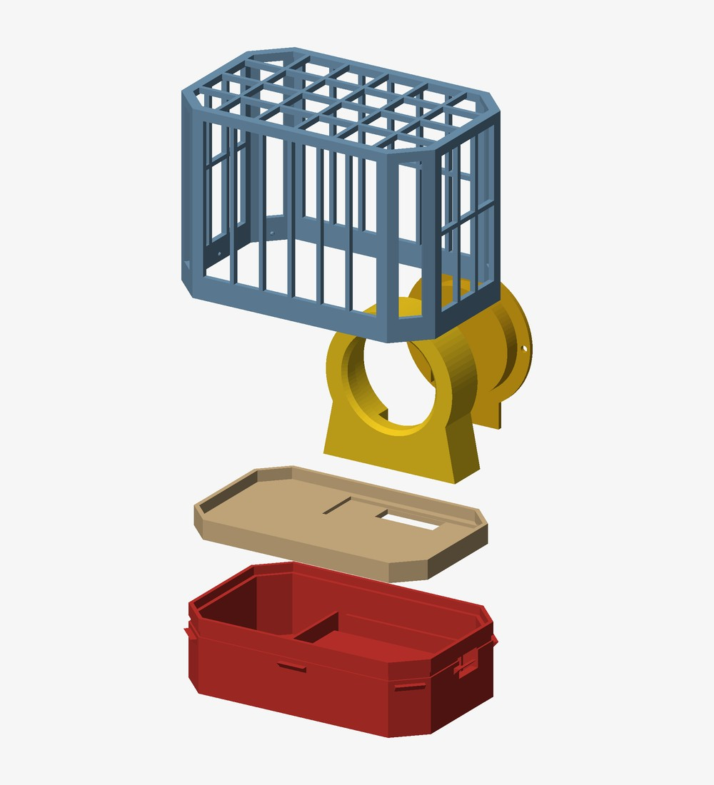
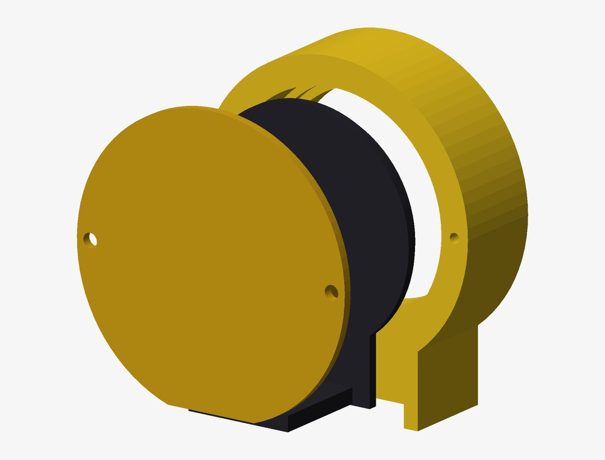
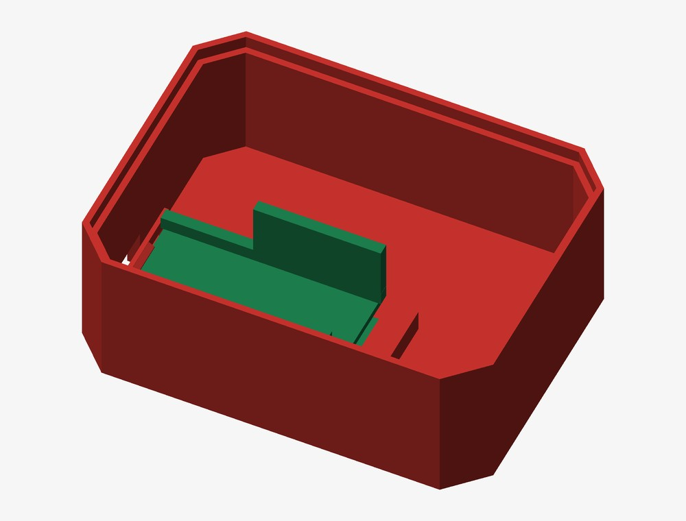

<!-- Hamster wheel desk toy -- by DeadPohl (https://www.instagram.com/_deadpohl_) -->
<!-- SPDX-License-Identifier: CC-BY-NC-SA-4.0 -->
<!-- French translation of README.md: keep both files in sync. -->
# Roue de hamster de bureau

[English](README.md) | **Français**

Une cage, une roue, et un hamster qui court **pour toujours** (ou du
moins tant qu'il est branché).

Le hamster est une courte animation jouée sur un petit écran rond caché dans la roue.
Vous imprimez les pièces en 3D, vous branchez 7 fils, vous chargez le programme depuis votre
navigateur web, et c'est fini. **Pas de soudure, pas de programmation.**

  
  

Ce guide est écrit pour quelqu'un qui n'a **jamais rien fait de ce genre**. Si un mot n'est pas
clair, cherchez-le dans le [lexique](#lexique) en bas de page. Si vous aimez bidouiller, le code et
le générateur des modèles 3D sont aussi ici : voir [Pour les makers](#makers).

> **Où en est le projet.** Tout est testé : l'électronique et le programme sur du vrai matériel,
> et toutes les pièces ont été imprimées et assemblées chez moi, avec ma propre imprimante.
> J'espère que ça marchera aussi bien chez vous ! Si une pièce ne va pas avec votre carte ou
> votre écran, dites-le-moi (ouvrez une Issue) : c'est sans doute une mesure qui change d'un
> vendeur à l'autre.

**Sommaire :** [Liste d'achats](#achats) -
[Étape 1 : tester l'électronique](#etape-1) - [Étape 2 : imprimer](#etape-2) -
[Étape 3 : assembler](#etape-3) - [Un problème ?](#problemes) - [Lexique](#lexique) -
[Pour les makers](#makers)

---

## 1. Matériel requis

Il vous faut **une imprimante 3D** (plateau d'au moins 220 x 220 mm), **un ordinateur** avec le
navigateur Chrome ou Edge, et les pièces ci-dessous. Comptez environ 15 à 25 euros
d'électronique et à peu près 100 g de filament. Les prix bougent, ce ne sont que des ordres de
grandeur.

### Électronique (seulement 3 choses à commander)

| # | Quoi | Combien | Comment le trouver | **À vérifier avant de payer** |
|---|---|---|---|---|
| 1 | **Carte ESP32** | 1 | Cherchez : `ESP32 DevKit 38 pin USB-C` (ou `ESP32 DevKitC V4`, `ESP32 DevKit V1 38 pins`) | La puce doit indiquer **ESP32-WROOM-32** (un ESP32 *S2, S3, C3 ou C6* ne marchera **pas**). **38 broches** (19 de chaque côté). Broches **déjà soudées** (la plupart des annonces disent "with pin headers"). Environ 55 x 28 mm. L'USB-C est le mieux (une carte micro-USB devrait aussi rentrer, mais ce n'est pas testé). |
| 2 | **Écran rond** | 1 | Cherchez : `GC9A01 1.28 inch round LCD 240x240 SPI` | Le nom **GC9A01**, **1,28 pouce**, **7 broches** (VCC, GND, SCL, SDA, DC, CS, RST), broches **déjà soudées**. Pas la version tactile, pas une version avec une nappe ou 8 broches. La partie ronde fait environ 38 mm de large. |
| 3 | **Fils Dupont, femelle-femelle** | 7 utiles (achetez un lot de 20 ou 40) | Cherchez : `Dupont jumper wire female to female 20cm` | **Femelle aux deux bouts** (une petite prise en plastique, pas une pointe en métal). 10 à 20 cm de long. |

### Ce que vous avez sans doute déjà

| Quoi | Remarques |
|---|---|
| **Câble USB** | Il doit transmettre des **données**, pas seulement charger (certains câbles bon marché ne font que charger). La prise côté ESP32 doit correspondre à la carte (USB-C ou micro-USB). Les grosses prises moulées de certains câbles peuvent ne pas passer dans l'ouverture : elle fait 12,5 mm de large. |
| **Alimentation USB** | N'importe quel chargeur de téléphone (5 V) ou un port USB d'ordinateur. |
| **Filament** | Environ 100 g en tout. PLA ou PETG pour toutes les pièces. Pour la cage, **le PETG est le plus sûr** (elle se plie sur des charnières très fines), mais le PLA marche aussi si vous suivez l'astuce de l'étape 2. Couleurs libres : l'original a un bac rouge, une roue jaune et une cage bleu clair. |
| **Copeaux de bois** | Une pincée. Les copeaux d'un taille-crayon sont parfaits. |
| **Trancheur (slicer)** | Le logiciel gratuit qui prépare un fichier 3D pour votre imprimante (PrusaSlicer, OrcaSlicer, Bambu Studio, Cura...). |

### En option

- Une goutte de colle forte, pour tenir le pied de la roue en place.
- Un pistolet à colle chaude, seulement si l'ESP32 a du jeu dans son logement (deux points).
- Un pied à coulisse ou une règle, pour vérifier vos pièces si quelque chose ne rentre pas.

---

## 2. Étape 1 : tester l'électronique (avant d'imprimer quoi que ce soit !)

Faites-le en premier. Si une pièce reçue a un défaut, vous le saurez avant de gaspiller du
filament. Ça prend 10 minutes.

### 2a. Mettre le programme dans l'ESP32

Vous n'avez rien à installer, seulement un navigateur **Chrome ou Edge** récent (Firefox et
Safari ne savent pas faire ça).

1. Téléchargez **`hamster-wheel-esp32.bin`** depuis la page [Releases](../../releases) de ce projet.
2. Branchez l'ESP32 à votre ordinateur avec le câble USB (l'écran n'est pas encore branché).
3. Ouvrez <https://espressif.github.io/esptool-js/> dans Chrome ou Edge.
4. Cliquez sur **Connect** et choisissez votre ESP32 dans la liste (il s'appelle souvent "CP210x", "CH340" ou "USB Serial").
5. Sous *Flash Address*, tapez `0x0`, cliquez sur **Choose File** et choisissez `hamster-wheel-esp32.bin`.
6. Cliquez sur **Program** et attendez d'arriver à 100 %.
7. Débranchez le câble, ou appuyez sur le petit bouton **EN** de la carte.

> **La liste est vide ou "Connect" échoue ?**
> - Essayez un autre câble USB : beaucoup de câbles ne font que charger.
> - **Windows :** installez le pilote de la puce USB de votre carte. Regardez la carte : une puce
>   marquée *CP2102* demande le [pilote Silicon Labs CP210x](https://www.silabs.com/developer-tools/usb-to-uart-bridge-vcp-drivers),
>   une *CH340* demande le "pilote CH340" (cherchez-le).
> - **Linux :** votre utilisateur doit peut-être faire partie du groupe `dialout`.
> - **Ça ne marche toujours pas :** maintenez le petit bouton **BOOT** de la carte pendant que
>   vous cliquez sur *Connect*, et relâchez-le quand la page indique qu'elle est connectée.

### 2b. Brancher l'écran

**Débranchez d'abord le câble USB.** Puis branchez les 7 fils exactement comme ceci :

| Broche de l'écran | Broche de l'ESP32 | Remarques |
|---|---|---|
| RST | **GPIO 16** | marquée `RX2` sur beaucoup de cartes |
| CS | **GPIO 5** | marquée `D5` |
| DC | **GPIO 17** | marquée `TX2` sur beaucoup de cartes |
| SCL | **GPIO 18** | marquée `D18` |
| SDA | **GPIO 23** | marquée `D23` |
| GND | **GND** | n'importe quelle broche nommée GND |
| VCC | **3V3** | marquée `3V3` ou `3.3V`. **Jamais la broche 5V.** |

Conseils :
- Les **noms sont imprimés sur les deux cartes**, à côté des broches : suivez les noms, pas la
  position. Certains écrans listent les broches dans l'ordre inverse.
- La couleur des fils n'a pas d'importance. Prenez une couleur différente pour chacun si vous
  pouvez, et notez laquelle va où.
- Enfoncez bien les prises en plastique jusqu'en bas des broches. Un fil mal enfoncé est la cause
  de la plupart des problèmes.
- La broche **3V3** est de l'**autre côté** de la carte par rapport aux autres : ce fil passe
  par-dessus la carte, c'est normal.

### 2c. Vérifier que ça marche

Branchez le câble USB. Au bout d'une seconde, **le hamster doit courir** sur l'écran.

Sinon, voyez [Un problème ?](#problemes). N'allez pas plus loin tant que ça ne marche pas.

---

## 3. Étape 2 : imprimer

Téléchargez les fichiers du dossier [`stl`](stl). Ils sont déjà dans la bonne position pour
l'impression : **ne les tournez pas**, et vous n'avez pas besoin de supports.

| Ordre | Fichier | Ce que c'est | Taille (mm) | Matière |
|---|---|---|---|---|
| 1 | `wheel.stl` | La roue (elle tient l'écran) | 48 x 55 x 15 | PLA ou PETG |
| 2 | `wheel_cap.stl` | Ferme l'arrière de la roue | 48 x 47 x 8 | PLA ou PETG |
| 3 | `esp_fit_test.stl` | En option : le logement de l'ESP32 seul, pour vérifier l'ajustement avant le bac | 56 x 36 x 11 | PLA ou PETG |
| 4 | `tray.stl` | Le bac rouge, l'ESP32 est couché au fond | 111 x 74 x 42 | PLA ou PETG |
| 5 | `platform.stl` | Le sol de la cage, au-dessus de l'ESP32 | 97 x 60 x 3 | PLA ou PETG |
| 6 | `dupont_cover.stl` | Cache les prises des fils derrière la roue | 24 x 21 x 13 | PLA ou PETG |
| 7 | `cage_net.stl` | La cage, imprimée **à plat** | 216 x 179 x 3 | PETG (le mieux) ou PLA |

Réglages qui marchent : hauteur de couche **0,2 mm**, remplissage **15 %**, **pas de supports**,
buse de 0,4 mm.

**Imprimez la roue en premier** (une impression courte). Vérifiez que la carte de l'écran (la
partie ronde et la languette avec les broches) rentre dedans par l'arrière, la vitre vers
l'avant. Si ce n'est pas le cas, **arrêtez-vous là** et ouvrez une Issue avec les mesures de votre
écran, avant d'imprimer le reste. Les makers peuvent aussi ajuster le modèle eux-mêmes
([détails, en anglais](docs/advanced.md#adjust-the-dimensions-to-your-parts)).

**À propos de la cage.** C'est une feuille plate de barreaux : un toit au milieu et 4 murs autour,
reliés par des charnières très fines (0,4 mm). Imprimez-la lentement (première couche lente,
plateau propre et bien nivelé). Vous la pliez ensuite, elle n'est pas collée.

*Astuce PLA :* les charnières ont tenu en PLA lors d'un premier essai. Par sécurité, chauffez
chaque charnière quelques secondes au sèche-cheveux avant de plier, et pliez chaque mur
lentement, **une seule fois**. Si une charnière casse quand même, une goutte de colle forte la
répare.

---

## 4. Étape 3 : assembler

  
  

**Gardez le câblage de l'[étape 1](#brancher-ecran).** L'écran et l'ESP32 restent reliés par les
7 fils pendant tout l'assemblage : vous ne débranchez jamais rien. Débranchez seulement le câble
USB.

**1. Mettez l'ESP32 dans le bac.** C'est la partie inhabituelle : la carte va **à l'envers**, au
fond du bac. L'écran pend au bout de ses fils pour l'instant.

- Le côté avec les **barrettes en plastique noir et les broches en métal** (et les fils) est
  tourné vers le **haut**. Le module WiFi argenté est tourné vers le **bas**.
- Le bout avec la **prise USB** va contre le **mur du fond**, là où il y a l'ouverture, et
  l'antenne (la petite languette noire à l'autre bout) pointe vers l'avant.
- Enfoncez-la à plat dans le **logement** bas au fond du bac : elle est ajustée et il la tient.
  Si votre carte a du jeu, ajoutez deux points de colle chaude entre son bord et les murets du
  logement, loin des deux petits boutons à côté de la prise USB.

**2. Mettez l'écran dans la roue.** Poussez l'écran dans la roue par l'**arrière**, vitre en
premier, avec la languette et sa rangée de broches en **bas**. Les prises des fils pointent droit
vers l'arrière, hors du pied : c'est normal, un petit cache les masque à la fin.

**3. Fermez la roue.** Enfoncez le **bouchon** rond à l'arrière de la roue, au-dessus des prises,
jusqu'à ce que son rebord touche la roue : cinq petites nervures le tiennent par friction (si
c'est trop serré, poncez-les un peu). Si l'écran bouge, un petit morceau de mousse adhésive entre
l'écran et le bouchon règle le problème.

**4. Posez la roue sur le plateau.** Mettez le pied de la roue dans son emplacement sur le plateau
(la plaque plate), les fils du côté de la **fente** qui va jusqu'au bord arrière. Le dessous du
pied est plat : une goutte de colle le tient en place.

**5. Mettez le plateau dans le bac.** Glissez les fils dans la fente par le bord arrière du
plateau, puis enfoncez le plateau dans le bac jusqu'à ce qu'il repose sur le rebord tout autour :
six petites nervures sur sa tranche le tiennent par friction. Les fils se replient dessous, il y a
la place. Si c'est trop serré, poncez un peu les nervures.

**6. Vérifiez encore.** Branchez le câble USB : le hamster doit courir. (Sinon, un fil s'est
débranché pendant l'assemblage.) Pour ouvrir l'objet plus tard, soulevez le plateau par la roue :
les fils sortent de la fente.

**7. Posez le cache sur les prises**, derrière la roue, contre le bouchon. Ses deux lèvres
descendent dans la fente et le tiennent.

**8. Étalez une pincée de copeaux sur le plateau**, jusqu'au bord, autour du pied de la roue et du
cache.

**9. Pliez et posez la cage.**
- Décollez la cage plate du plateau d'impression.
- Pliez les 4 murs vers le côté qui était **tourné vers le haut** pendant l'impression, l'un après
  l'autre : les fines charnières se retrouvent à l'extérieur.
- Retournez la cage (toit en haut) et posez-la sur le bac.
- Enfoncez le bas des murs dans la **rainure** qui fait le tour du haut du bac. Commencez par les
  deux grands côtés. La rainure tient les murs : **pas besoin de colle**. Une petite bosse sur
  chaque mur s'enclenche dans un petit creux du rebord.
- Pour ouvrir l'objet, tirez la cage tout droit vers le haut.

C'est fini !

Le câble USB sort par l'ouverture à l'arrière du bac. Il alimente l'objet, et c'est aussi par lui
que vous pourrez changer le programme plus tard sans rien ouvrir.

---

## Un problème ?

| Ce que vous voyez | Ce qu'il faut faire |
|---|---|
| Le navigateur ne montre aucun port au moment de flasher | Essayez un autre câble USB (les câbles qui ne font que charger sont courants), un autre port USB, et installez le pilote de la puce USB de votre carte (voir l'étape 2a). |
| Le flashage échoue ou s'arrête | Maintenez le bouton **BOOT** de l'ESP32 pendant que vous cliquez sur *Connect*. |
| Écran noir | Vérifiez les 7 fils un par un : **3V3**, **GND**, puis **CS (5), DC (17), RST (16)**. Enfoncez bien chaque prise. |
| Écran blanc | SCL et SDA sont inversés (18 et 23), ou GND est mal branché. |
| L'image scintille ou a des parasites | Une prise est mal enfoncée, ou les fils sont trop longs. Enfoncez les prises. |
| L'image est tournée ou en miroir | Dites-moi (ouvrez une Issue) dans quel sens elle est tournée : c'est une ligne à changer dans le programme. |
| Les couleurs sont fausses | Vérifiez que vous avez flashé la **dernière** version de `hamster-wheel-esp32.bin` depuis la page Releases. |
| L'écran ne rentre pas dans la roue | Arrêtez d'imprimer et ouvrez une Issue avec les mesures de votre écran. |
| La prise du câble ne passe pas dans l'ouverture du bac | L'ouverture fait 12,5 mm de large. Il faut un câble avec une prise moulée plus petite. |
| L'ESP32 ne rentre pas dans le bac | Les cartes varient de quelques millimètres d'un vendeur à l'autre : ouvrez une Issue avec sa longueur, sa largeur, et de combien l'antenne dépasse. |
| La cage a du mal à entrer dans la rainure | Commencez par les deux grands côtés, laissez les murs se mettre en place, et appuyez sur les coins en dernier. |

---

## Lexique

- **ESP32** : une toute petite carte ordinateur pas chère avec du WiFi, utilisée ici seulement
  pour jouer l'animation.
- **GC9A01** : le nom de la puce qui pilote le petit écran rond.
- **Barrette de broches** (*pin header*) : la rangée de broches en métal soudée le long d'une
  carte, pour pouvoir y brancher des fils.
- **Fil Dupont** : un fil avec une prise en plastique à chaque bout. *Femelle* veut dire que le
  bout est une prise qu'on enfonce sur une broche.
- **GPIO** : une des broches numérotées de la carte ESP32 (GPIO 5, GPIO 16...).
- **Flasher** : copier un programme dans la mémoire de l'ESP32. On le fait une fois ; le programme
  reste même quand l'alimentation est coupée.
- **PLA / PETG** : deux plastiques courants en impression 3D. Le PLA est facile mais cassant ; le
  PETG est un peu plus résistant et souple, ce dont les charnières de la cage ont besoin.
- **Trancheur** (*slicer*) : le logiciel qui transforme un fichier 3D en instructions pour votre
  imprimante.
- **Supports** : un échafaudage en plus dont certaines impressions ont besoin. Aucune de ces
  pièces n'en a besoin.

---

## Pour les makers

Tout le code est ici, et tout peut être modifié (documentation technique en anglais) :

- [**docs/advanced.md**](docs/advanced.md) : recompiler le programme avec PlatformIO, changer
  l'animation (n'importe quel GIF), changer les broches, régénérer les modèles 3D après avoir
  changé une dimension, dépannage technique.
- [`firmware/`](firmware) : le programme de l'ESP32 (PlatformIO, framework Arduino, TFT_eSPI,
  TJpg_Decoder).
- [`cad/`](cad) : les modèles 3D sont générés par du code Python (build123d) ; toutes les
  dimensions sont dans [`cad/params.py`](cad/params.py).
- [`tools/`](tools) : `make_animation.py` transforme un GIF en fichier d'animation.

## Licence et crédits

- Code (firmware, outils, générateur des modèles 3D) : [PolyForm Noncommercial 1.0.0](LICENSE.md)
- Modèles 3D, documentation et images : [CC BY-NC-SA 4.0](LICENSE-models.txt)
- L'animation du hamster est un GIF du domaine public.
- Bibliothèques : [TFT_eSPI](https://github.com/Bodmer/TFT_eSPI) et
  [TJpg_Decoder](https://github.com/Bodmer/TJpg_Decoder) par Bodmer,
  [build123d](https://github.com/gumyr/build123d) pour les modèles.

Par DeadPohl, <https://www.instagram.com/_deadpohl_>
