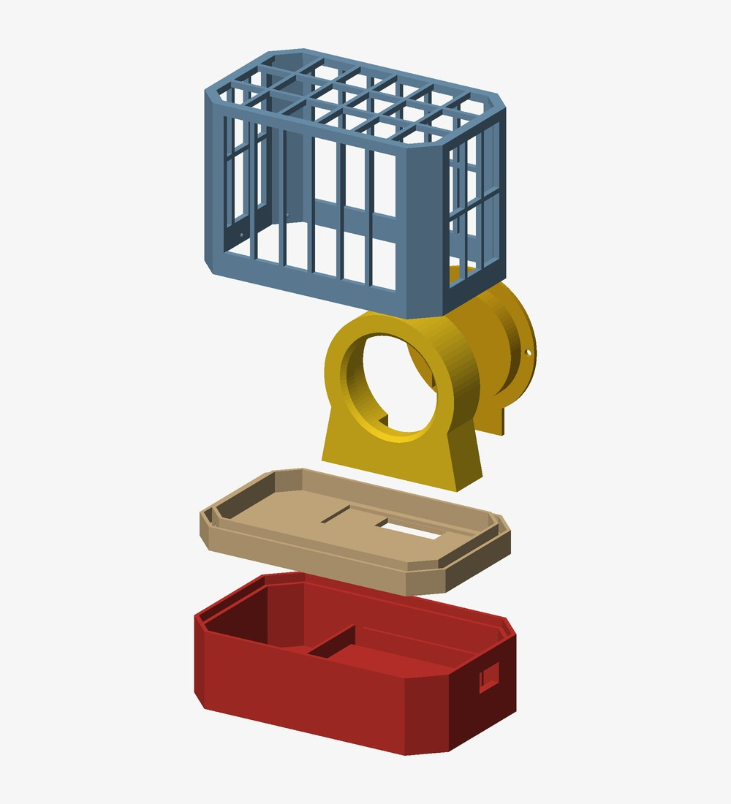
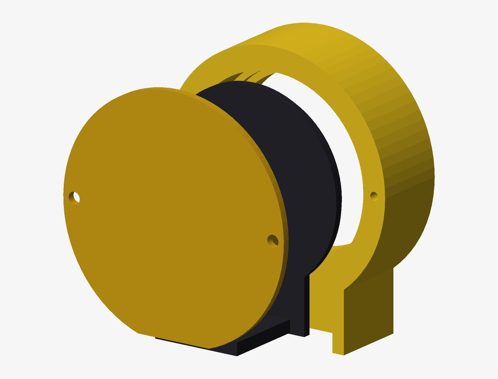
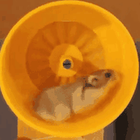

<!-- Hamster wheel desk toy -- by DeadPohl (https://www.instagram.com/_deadpohl_) -->
<!-- SPDX-License-Identifier: CC-BY-NC-SA-4.0 -->
# Hamster wheel desk toy

A tiny desk "hamster cage" where a hamster runs forever in its wheel. The wheel
is a round GC9A01 screen driven by an ESP32, the cage and the tray are 3D printed,
and a bit of wood shavings on the lid finishes the job.

<p align="center">
  
  
</p>

> **Status.** The firmware builds and uses the same pins as the first prototype.
> The 3D models are generated by code and checked in CAD (closed meshes, no
> collisions between parts) but **have not been test printed yet**. The display and
> ESP32 dimensions come from datasheets, which vary between sellers. Measure
> your own parts and adjust [cad/params.py](cad/params.py) before printing the big parts
> (see [Print](#3-print)).

## What is in the box

| Part | What it does |
|---|---|
| **Tray** (red) | Holds the ESP32 on a central rib, lying lengthwise right under the wheel, with a USB-C opening in the right wall for the power cable. |
| **Lid** | Closes the tray. Its raised rim keeps the wood shavings on it and has a **groove all around where the cage plugs in**. It also has a seat for the wheel foot and a slot for the wires. |
| **Wheel** and **wheel cap** (yellow) | The display sits in the ring, looking through a short tunnel (the "wheel"). The cap closes the back and hides the wires. |
| **Cage** (blue) | Printed **flat** in one go: the roof in the middle and a wall hinged around each edge. You fold it and push it into the groove of the lid: **no glue**. The bars are far apart so you can see the wheel. |

## What you need

- ESP32 DevKit, 38 pins, USB-C (any ESP32-WROOM board works, see the size note below)
- GC9A01 1.28" round display module, 240x240, **7 pin version** (VCC GND SCL SDA DC CS RST)
- About 20 cm of thin multi-core wire (28 AWG ribbon is perfect), 7 conductors
- A USB-C cable and a 5 V phone charger
- Wood shavings (pencil sharpener shavings work great)
- Optional: 2 self-tapping M2 x 6 screws for the wheel cap (glue works too)
- A soldering iron. You can test everything first with jumper wires.

## 1. Flash the ESP32 (no tools to install)

1. Download `hamster-wheel-esp32.bin` from the [Releases](../../releases) page.
2. Plug the ESP32 into your computer.
3. Open <https://espressif.github.io/esptool-js/> in **Chrome or Edge**.
4. Click **Connect**, pick the serial port of your ESP32.
5. Set the flash address to `0x0`, choose the `.bin` file, click **Program**.
6. Press the `EN` (reset) button when it is done.

If the connection fails, hold the `BOOT` button while you click Connect and release it
when "Connecting..." changes. Windows may need the CP210x or CH340 driver, depending
on your board.

Command line alternative:

```
pip install esptool
esptool.py --chip esp32 --port COM5 write_flash 0x0 hamster-wheel-esp32.bin
```

## 2. Wire it

The display uses 3.3 V logic. Do **not** connect VCC to 5 V.

| Display | ESP32 pin |
|---|---|
| VCC | **3V3** |
| GND | GND |
| SCL (CLK) | **GPIO 18** |
| SDA (MOSI, DIN) | **GPIO 23** |
| DC | **GPIO 17** |
| CS | **GPIO 5** |
| RST | **GPIO 16** |

Power the ESP32 over USB-C. The hamster should start running. **Test it on the bench
with jumper wires before soldering and printing anything.**

To use other pins, edit `build_flags` in [firmware/platformio.ini](firmware/platformio.ini)
and rebuild (see [Build from source](#build-from-source)).

## 3. Print

The STL files in [stl/](stl) are already in their print orientation. None needs supports.

| File | Orientation | Notes |
|---|---|---|
| `wheel.stl` | front face on the bed | Print this one first, it is the fit test for your display. About 15 min. |
| `wheel_cap.stl` | flange on the bed | |
| `tray.stl` | floor on the bed | 94 x 60 x 26 mm |
| `lid.stl` | top side up | 91 x 57 x 10 mm |
| `cage_net.stl` | flat, outer faces on the bed | 206 x 172 x 2.6 mm, fits a 220 mm bed. **Print it in PETG**: the 8 hinges are 0.6 mm films that PLA would crack. |

PLA or PETG, 0.2 mm layers, 15% infill is fine for the rest. Pick the colours you like: the original
is a red tray, yellow wheel and light blue cage.

**About the cage net.** It is only 2 mm thick, so it prints fast and uses little plastic. Slow the
first layers down a little. If you prefer PLA, set `HINGES = False` in `cad/params.py`: the walls
then print as separate panels and you glue them to the roof (the mitred edges make that easy).

### Adjust the dimensions to your parts

Datasheets disagree (round PCB from 37.5 to 38 mm, ESP32 boards from 48 to 55 mm long),
so measure yours with calipers and edit the lines tagged `measure me` in
[cad/params.py](cad/params.py):

| Value | What to measure |
|---|---|
| `LCD_PCB_D` | outer diameter of the round display PCB |
| `LCD_GLASS_D` | diameter of the glass on top of it |
| `LCD_PCB_T`, `LCD_GLASS_T` | PCB thickness, glass height |
| `ESP_L`, `ESP_W` | board length and width |
| `ESP_PIN_LEN` | how far the header pins stick out below the board |
| `USB_HOLE_W`, `USB_HOLE_H` | size of your USB-C plug body (some cables have a big moulded end) |

The same file has the shape settings: `TRAY_L` and `TRAY_W` (footprint), `CORNER_CUT` (the
chamfered corners, 0 for square ones), `WALL_PITCH` (gap between the cage bars) and the hinge
settings.

Then regenerate the STL files:

```
cd cad
pip install -r requirements.txt        # Python 3.10 or newer
python build_all.py                      # STL into ../stl, previews into ../docs/img
```

The script checks that every part is a closed mesh and that assembled parts do not collide.

## 4. Assemble

<p align="center">
  
  
</p>
<p align="center">
  
</p>

1. **Solder the display.** Solder 7 wires (about 12 cm) to the display pads. If your module has
   a pin header, solder to the pins and trim the tips. There are 6 mm of free space behind
   the PCB, and a notch in the cap for the solder joints.
2. **Fit the display.** Push it into the wheel from the **back**, glass first, with the wire pads
   at the bottom. It sits in two steps: the glass in the narrow seat, the PCB in the wider one.
   Run the wires down the channel in the foot.
3. **Close the wheel.** Press the cap in: its ring pushes on the PCB edge and its tail covers the
   channel. Add the two M2 screws, or a drop of glue. If the display rattles, put a strip of
   foam tape between the PCB and the cap.
4. **Wheel on the lid.** Feed the wires through the slot in the lid and set the foot in its seat
   (a drop of glue keeps it in place).
5. **ESP32 in the tray.** Solder the 7 wires to the ESP32 (to the top of the header pins, see
   the wiring table). Set the board on the central rib, USB-C end against the right wall, in line
   with the opening. With the USB-C port on the right, the pin row with GPIO 18, 23, 5, 17
   and 16 is at the back, right under the wire slot (3V3 is in the other row, at the far end).
   The wheel stands right above the board, so the wires are short. The header pins hang on both sides of the rib.
6. **Close the tray.** Drop the lid into its seat. The wheel is now stuck to the lid and the
   whole thing opens like a box.
7. **Cage.** Take the net off the bed and fold the 8 walls toward the side that was facing up
   while printing, so the hinge films end up on the outside and the mitred edges meet in the
   corners. Then turn it over (roof on top), set the cage on the lid and push
   the solid skirts at the bottom of the walls into the groove that runs around the rim. The
   groove holds every wall in place, which closes the corners without glue, and the small bump
   on each wall clicks into a dimple of the rim. Pull it straight up to take it off, and you can
   then lift the lid with the wheel to reach the ESP32. The lower outer wall of the rim guides
   the walls in: start with the long sides.
8. **Shavings.** Spread a few on the lid. This toy is a decoration: no real hamster inside.

The USB-C cable goes through the right side of the tray. It powers the ESP32 and also lets you
re-flash it without opening anything.

## Change the animation

Any GIF will do, it is cropped to a square and resized to 240x240.

```
cd tools
pip install -r requirements.txt
python make_animation.py my.gif                 # uses the GIF frame delays
python make_animation.py my.gif --fps 20        # or force a frame rate
python make_animation.py my.gif --quality 70 --step 2    # smaller file
```

It writes [firmware/assets/animation.bin](firmware/assets). Then build and flash
(see below). `make_animation.py --help` lists every option. A folder of numbered images
works too, like the original frames in [firmware/assets/hamster](firmware/assets/hamster).

<p align="center"></p>

## Build from source

Install [PlatformIO](https://platformio.org/install) (VS Code extension or `pip install platformio`).

```
cd firmware
pio run -t upload          # build and flash over USB
pio device monitor         # serial log with the measured frame rate
```

A normal build also writes `.pio/build/esp32dev/hamster-wheel-esp32.bin`, the single image
used in step 1. All pins and the display driver are set in `platformio.ini`, so you never
have to edit a library file. User settings (screen rotation) are in
[firmware/src/config.h](firmware/src/config.h).

## Troubleshooting

| Symptom | Try |
|---|---|
| Black screen | Check the 7 wires, especially CS (5), DC (17), RST (16) and 3V3. Open the serial monitor: you should see the frame count. |
| White screen | SCL and SDA swapped, or a poor ground. |
| Picture rotated | Change `SCREEN_ROTATION` in `config.h` (0 to 3). |
| Garbage or flicker | Long or thin wires: lower `SPI_FREQUENCY` to `27000000` in `platformio.ini`. |
| Colours negative or red and blue swapped | Add `-DTFT_INVERSION_ON` (or `-DTFT_INVERSION_OFF`), or `-DTFT_RGB_ORDER=TFT_BGR`, to `build_flags`. |
| Animation too slow | See the fps in the serial monitor. Use a smaller GIF with `--step 2`, or raise `SPI_FREQUENCY` to `80000000` if your wires are short. |
| "too big" from make_animation | Lower `--quality`, use `--step 2`, or fewer frames. |
| Upload fails | Hold `BOOT` while it connects, try another USB cable (some are charge only) and check the port. |
| Display does not fit the wheel | Measure it and adjust `cad/params.py`, then rebuild the STL. |

## Repository layout

```
firmware/   PlatformIO project (ESP32, TFT_eSPI, TJpg_Decoder), animation in assets/
cad/        parametric 3D model generator (build123d), params.py holds every dimension
stl/        ready to print files (the cage is one flat net, cage_net.stl)
tools/      make_animation.py: GIF to animation.bin
docs/img/   pictures used in this README
release/    (not tracked) the merged firmware image is attached to GitHub Releases
```

## License and credits

- Code (firmware, tools, CAD generator): [PolyForm Noncommercial 1.0.0](LICENSE.md)
- 3D models, documentation and pictures: [CC BY-NC-SA 4.0](LICENSE-models.txt)
- The hamster animation is a public domain GIF.
- Libraries: [TFT_eSPI](https://github.com/Bodmer/TFT_eSPI) and
  [TJpg_Decoder](https://github.com/Bodmer/TJpg_Decoder) by Bodmer,
  [build123d](https://github.com/gumyr/build123d) for the models.

By DeadPohl, <https://www.instagram.com/_deadpohl_>


