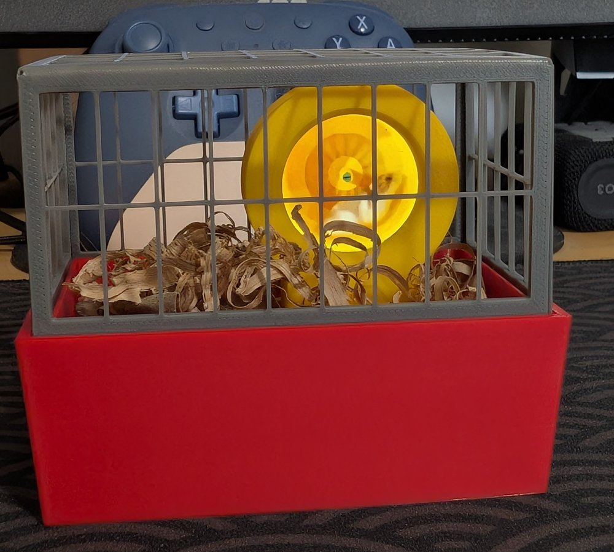
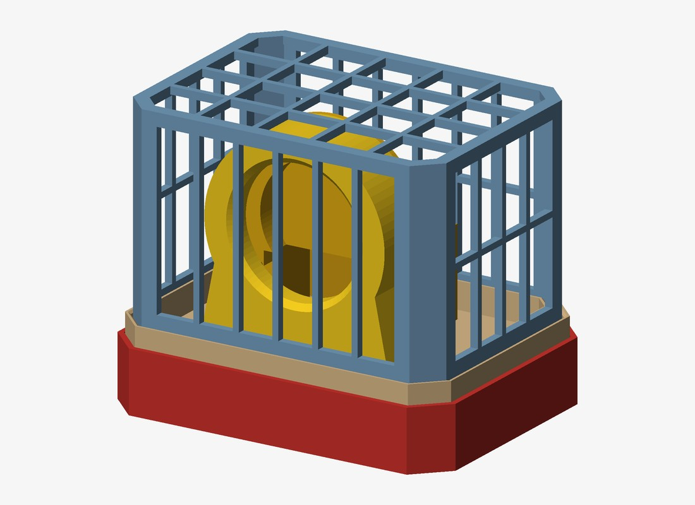
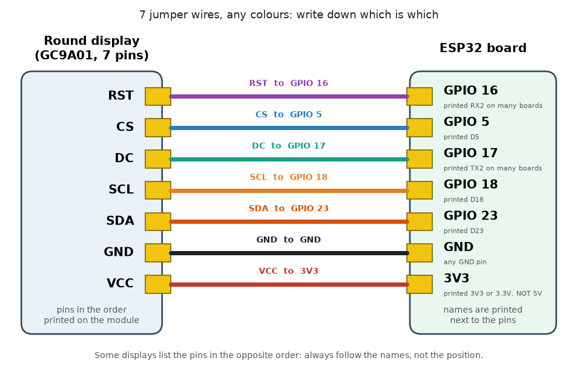
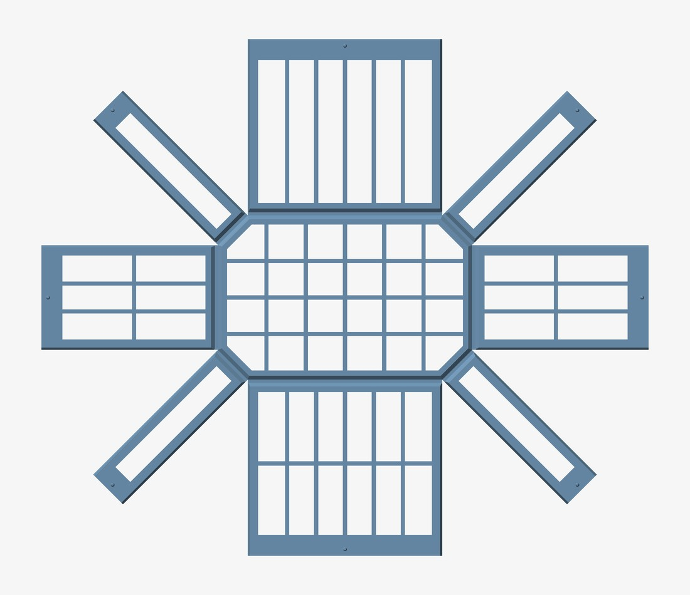
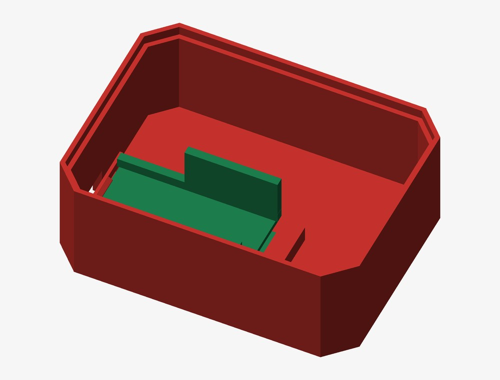

<!-- Hamster wheel desk toy -- by DeadPohl (https://www.instagram.com/_deadpohl_) -->
<!-- SPDX-License-Identifier: CC-BY-NC-SA-4.0 -->
# Hamster Wheel Desk Toy

A tiny desk toy: a cage, a wheel, and a hamster that runs **forever**.

The hamster is a short animation played on a small round screen hidden in the wheel.
You 3D print the parts, plug 7 wires, load the program from your web browser, and you are done.
**No soldering and no programming.**

  
  

This guide is written for someone who has **never done anything like this**. If a word is
unclear, look it up in [Words explained](#words-explained) at the bottom. If you like to tinker,
the code and the 3D model generator are all here too: see [For makers](#for-makers).

> **Where the project stands.** Everything is tested: the electronics and the program on real
> hardware, and every printed part was printed and assembled at home, on my own printer. I hope
> it works just as well on yours! If a part does not fit your board or screen, please tell me
> (open an Issue): it is probably a measurement that varies between sellers.

**Contents:** [Shopping list](#1-shopping-list) -
[Step 1: test the electronics](#2-step-1-test-the-electronics-before-printing-anything) -
[Step 2: print](#3-step-2-print) - [Step 3: assemble](#4-step-3-assemble) -
[Problems?](#problems) - [Words explained](#words-explained) - [For makers](#for-makers)

---

## 1. Shopping list

You need **a 3D printer** (bed of at least 220 x 220 mm), **a computer**
with the Chrome or Edge browser, and the parts below. Roughly 15 to 25 euros of electronics and
about 100 g of filament. Prices change, these are only orders of magnitude.

### Electronics (only 3 things to order)

| # | What | How many | How to find it | **Check before you pay** |
|---|---|---|---|---|
| 1 | **ESP32 board** | 1 | Search: `ESP32 DevKit 38 pin USB-C` (or `ESP32 DevKitC V4`, `ESP32 DevKit V1 38 pins`) | The chip must say **ESP32-WROOM-32** (an ESP32 *S2, S3, C3 or C6* will **not** work). **38 pins** (19 on each side). Pins **already soldered** on (most listings say "with pin headers"). About 55 x 28 mm. USB-C is best (a micro-USB board should fit too, but it is not tested). |
| 2 | **Round screen** | 1 | Search: `GC9A01 1.28 inch round LCD 240x240 SPI` | The name **GC9A01**, **1.28 inch**, **7 pins** (VCC, GND, SCL, SDA, DC, CS, RST), pins **already soldered**. Not the touch version, not a version with a cable or 8 pins. The round board is about 38 mm wide. |
| 3 | **Dupont jumper wires, female to female** | 7 needed (buy a pack of 20 or 40) | Search: `Dupont jumper wire female to female 20cm` | **Female on both ends** (a little plastic socket, not a metal pin). 10 to 20 cm long. |

### What you probably already have

| What | Notes |
|---|---|
| **USB cable** | Must carry **data**, not only charge (some cheap cables only charge). The plug on the ESP32 board's side must match the board (USB-C or micro-USB). The big moulded plugs of some cables may not fit the opening: it is 11.5 x 7 mm. |
| **USB power** | Any phone charger (5 V) or a USB port of a computer. |
| **Filament** | About 100 g in total. PLA or PETG for every part. For the cage, **PETG is the safest** (it folds on thin hinges), but PLA works too if you follow the tip in step 2. Colours are free: the original is a red tray, yellow wheel and light blue cage. |
| **Wood shavings** | A pinch. The shavings from a pencil sharpener are perfect. |
| **Slicer** | The free program that prepares a 3D file for your printer (PrusaSlicer, OrcaSlicer, Bambu Studio, Cura...). |

### Optional

- A drop of super glue, to keep the wheel's foot in place.
- A hot glue gun, only if the ESP32 is loose in its pocket (two dots).
- A calliper or a ruler, to check your parts if something does not fit.

---

## 2. Step 1: test the electronics (before printing anything!)

Do this first. If something is wrong with a part you received, you find out before wasting
filament. It takes 10 minutes.

### 2a. Put the program in the ESP32

You do not need to install anything, only a recent **Chrome or Edge** browser (Firefox and Safari
do not work for this).

1. Download **`hamster-wheel-esp32.bin`** from the [Releases](../../releases) page of this project.
2. Plug the ESP32 into your computer with the USB cable (the screen is not connected yet).
3. Open <https://espressif.github.io/esptool-js/> in Chrome or Edge.
4. Click **Connect** and choose your ESP32 in the list (it is often called "CP210x", "CH340" or "USB Serial").
5. Under *Flash Address*, type `0x0`, click **Choose File** and pick `hamster-wheel-esp32.bin`.
6. Click **Program** and wait until it reaches 100 %.
7. Unplug the cable, or press the small **EN** button on the board.

> **The list is empty or "Connect" fails?**
> - Try another USB cable: many cables are charge-only.
> - **Windows:** install the driver for your board's USB chip. Look at the board: a chip labelled
>   *CP2102* needs the [Silicon Labs CP210x driver](https://www.silabs.com/developer-tools/usb-to-uart-bridge-vcp-drivers),
>   a *CH340* needs the "CH340 driver" (search for it).
> - **Linux:** your user may need to be in the `dialout` group.
> - **Still failing:** hold the small **BOOT** button on the board while you click *Connect*, and
>   let go once the page shows that it is connected.

### 2b. Plug the screen

**Unplug the USB cable first.** Then connect the 7 wires exactly like this:

| Screen pin | ESP32 pin | Remarks |
|---|---|---|
| RST | **GPIO 16** | printed `RX2` on many boards |
| CS | **GPIO 5** | printed `D5` |
| DC | **GPIO 17** | printed `TX2` on many boards |
| SCL | **GPIO 18** | printed `D18` |
| SDA | **GPIO 23** | printed `D23` |
| GND | **GND** | any pin named GND |
| VCC | **3V3** | printed `3V3` or `3.3V`. **Never the 5V pin.** |

Tips:
- The **names are printed on both boards**, next to the pins: follow the names, not the position.
  Some screens list the pins in the opposite order.
- The wires do not need to be a particular colour. Use a different colour for each one if you can,
  and write down which is which.
- Push the plastic sockets all the way down onto the pins. A loose wire is the cause of most problems.
- The **3V3** pin is on the **other side** of the board than the others: that wire crosses over the board, it is normal.

### 2c. Check that it works

Plug the USB cable. After one second **the hamster should be running** on the screen.

If not, see [Problems?](#problems). Do not go further until it works.

---

## 3. Step 2: print

Download the files from the [`stl`](stl) folder. They are already in the right position for
printing: **do not rotate them**, and you do not need supports.

| Order | File | What it is | Size (mm) | Material |
|---|---|---|---|---|
| 1 | `wheel.stl` | The wheel (holds the screen) | 48 x 55 x 15 | PLA or PETG |
| 2 | `wheel_cap.stl` | Closes the back of the wheel | 48 x 47 x 8 | PLA or PETG |
| 3 | `esp_fit_test.stl` | Optional: the ESP32 pocket alone, to check the fit before the tray | 56 x 36 x 11 | PLA or PETG |
| 4 | `tray.stl` | The red tub, the ESP32 lies at the bottom | 111 x 74 x 42 | PLA or PETG |
| 5 | `platform.stl` | The floor of the cage, over the ESP32 | 97 x 60 x 3 | PLA or PETG |
| 6 | `dupont_cover.stl` | Hides the wire sockets behind the wheel | 24 x 21 x 13 | PLA or PETG |
| 7 | `cage_net.stl` | The cage, printed **flat** | 216 x 179 x 3 | PETG (best) or PLA |

Settings that work: layer height **0.2 mm**, infill **15 %**, **no supports**, 0.4 mm nozzle.

**Print the wheel first** (a short print). Check that the screen board (the round part and the tab with the pins)
drops into it from the back, with the glass facing the front. If it does not, **stop here** and open an Issue with the measurements of
your screen, before printing the rest. Makers can also adjust the model themselves
([details](docs/advanced.md#adjust-the-dimensions-to-your-parts)).

**About the cage.** It is a flat sheet of bars: a roof in the middle and 4 walls around it, linked by
very thin hinges (0.4 mm). Print it slowly (a slow first layer, a clean and well levelled bed).
You fold it afterwards, it is not glued.

*PLA tip:* the hinges held in PLA in a first test. To be safe, warm each hinge for a few seconds
with a hair dryer before folding, and fold each wall slowly, **once**. If a hinge breaks anyway,
a drop of super glue repairs it.

---

## 4. Step 3: assemble

  
  

**1. Put the ESP32 in the tray.** This is the unusual part: the board goes in **upside down**, at
the bottom of the tray.

- The side with the **black plastic strips and the metal pins** faces **up**. The silver WiFi module
  faces **down**.
- The **USB plug** end goes to the **back wall**, where the opening is, and the antenna (the short
  black tongue at the other end) points to the front.
- Press it flat into the low **pocket** on the floor: it is a snug fit that holds it. If your
  board is loose, add two dots of hot glue between its edge and the pocket walls, away from the
  two small buttons next to the USB socket.

**2. Put the wheel on the platform.** Set the wheel's foot in its seat on the platform (the flat
plate). The bottom of the foot is flat: a drop of glue keeps it in place.

**3. Put the screen in the wheel.** Push the screen into the wheel from the **back**, glass first,
with the tab and its row of pins at the **bottom**. Plug the 7 jumper wires onto the screen's pins
(use the same wires you tested with). The sockets point straight backwards, out of the back of
the foot: that is normal, a small cover hides them at the end.

**4. Close the wheel.** Push the round **cap** into the back of the wheel, above the sockets, until
its rim touches the wheel: five small ribs hold it by friction (if it is too tight, sand them a
little). If the screen rattles, a small piece of foam tape between the screen and the cap fixes it.

**5. Connect.** Plug the other end of the 7 wires onto the ESP32 pins (table above). Hold the
platform above the tray and slide the wires into the **slot** behind the wheel, from the back
edge of the platform: nothing to unplug. Then push the platform down into the tray until it rests
on the ledge all around: six small ribs on its edge hold it by friction. The wires curl
underneath, there is room for them. If it is too tight, sand the ribs a little.

**6. Check again.** Plug the USB cable: the hamster must run. (If not, a wire came loose during
assembly.) To open the toy later, lift the platform by the wheel: the wires slide out of the slot.

**7. Put the cover over the sockets** behind the wheel, against the cap. Its two lips drop into the
slot and hold it.

**8. Spread a pinch of shavings on the platform**, up to the rim, around the foot of the wheel and
the cover.

**9. Fold and place the cage.**
- Take the flat cage off the bed.
- Fold the 4 walls toward the side that was **facing up** while printing, one after the other:
  the thin hinges end up on the outside.
- Turn the cage over (roof on top) and set it on the tray.
- Push the bottom of the walls into the **groove** that runs along the top of the tray. Start with
  the two long sides. The groove holds the walls: **no glue needed**. A small bump on each wall
  clicks into a small hole in the rim.
- To open the toy, pull the cage straight up.

Done! This toy is a decoration: **no real hamster inside**.

The USB cable goes out through the opening at the back of the tray. It powers the toy, and it is
also how you can change the program later without opening anything.

---

## Problems?

| What you see | What to do |
|---|---|
| The browser shows no port when flashing | Try another USB cable (charge-only cables are common), another USB port, and install the driver for your board's USB chip (see step 2a). |
| Flashing fails or stops | Hold the **BOOT** button on the ESP32 while you click *Connect*. |
| Black screen | Check the 7 wires, one by one: **3V3**, **GND**, then **CS (5), DC (17), RST (16)**. Push every plug firmly. |
| White screen | SCL and SDA are swapped (18 and 23), or GND is loose. |
| The picture flickers or is noisy | A plug is loose, or the wires are too long. Push the plugs down. |
| The picture is turned or mirrored | Tell me (open an Issue) which way it is turned: it is a one-line change in the program. |
| The colours look wrong | Make sure you flashed the **latest** `hamster-wheel-esp32.bin` from the Releases page. |
| The screen does not fit in the wheel | Stop printing and open an Issue with the measurements of your screen. |
| A cable plug does not fit the tray opening | The opening is 12.5 mm wide. A cable with a smaller moulded plug is needed. |
| The ESP32 does not fit in the tray | Boards differ by a few millimetres between sellers: open an Issue with its length and width, and how far the antenna sticks out. |
| The cage is hard to push into the groove | Start with the two long sides, let the walls spring into place, and press the corners last. |

---

## Words explained

- **ESP32**: a very small, cheap computer board with WiFi, used here only to play the animation.
- **GC9A01**: the name of the chip that drives the small round screen.
- **Pin header**: the row of metal pins soldered along the edge of a board, so you can plug wires on it.
- **Dupont jumper wire**: a wire with a plastic plug at each end. *Female* means the end is a socket
  that you push onto a pin.
- **GPIO**: one of the numbered pins of the ESP32 board (GPIO 5, GPIO 16...).
- **Flashing**: copying a program into the ESP32's memory. It is done once; the program stays
  even when the power is off.
- **PLA / PETG**: two common 3D printing plastics. PLA is easy but brittle; PETG is a bit tougher
  and flexible, which the cage's hinges need.
- **Slicer**: the software that turns a 3D file into instructions for your printer.
- **Supports**: extra scaffolding some prints need. None of these parts need it.

---

## For makers

All the code is here, and everything can be changed:

- [**docs/advanced.md**](docs/advanced.md): rebuild the program with PlatformIO, change the
  animation (any GIF), change the pins, regenerate the 3D models after changing a dimension,
  technical troubleshooting.
- [`firmware/`](firmware): the ESP32 program (PlatformIO, Arduino framework, TFT_eSPI, TJpg_Decoder).
- [`cad/`](cad): the 3D models are generated by Python code (build123d); every dimension is in
  [`cad/params.py`](cad/params.py).
- [`tools/`](tools): `make_animation.py` turns a GIF into the animation file.

## License and credits

- Code (firmware, tools, 3D model generator): [PolyForm Noncommercial 1.0.0](LICENSE.md)
- 3D models, documentation and pictures: [CC BY-NC-SA 4.0](LICENSE-models.txt)
- The hamster animation is a public domain GIF.
- Libraries: [TFT_eSPI](https://github.com/Bodmer/TFT_eSPI) and
  [TJpg_Decoder](https://github.com/Bodmer/TJpg_Decoder) by Bodmer,
  [build123d](https://github.com/gumyr/build123d) for the models.

By DeadPohl, <https://www.instagram.com/_deadpohl_>
