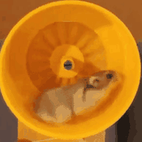

<!-- Hamster wheel desk toy -- by DeadPohl (https://www.instagram.com/_deadpohl_) -->
<!-- SPDX-License-Identifier: CC-BY-NC-SA-4.0 -->
# For makers

This page is for people who want to modify the toy: another animation, other pins, other
dimensions. The beginner guide is the [README](../README.md).

## Repository layout

```
firmware/   PlatformIO project (ESP32, TFT_eSPI, TJpg_Decoder), animation in assets/
cad/        parametric 3D model generator (build123d), params.py holds every dimension
stl/        ready to print files (the cage is one flat net, cage_net.stl)
tools/      make_animation.py: GIF to animation.bin, make_wiring_diagram.py: the README diagram
docs/       this page and the pictures used in the README
release/    (not tracked) the merged firmware image is attached to GitHub Releases
```

## Build the firmware from source

Install [PlatformIO](https://platformio.org/install) (VS Code extension or `pip install platformio`).

```
cd firmware
pio run -t upload          # build and flash over USB
pio device monitor         # serial log: frame count and measured frame rate
```

A normal build also writes `.pio/build/esp32dev/hamster-wheel-esp32.bin`, the single image that
is attached to the releases (flash it at address `0x0`). All pins and the display driver are set in
`firmware/platformio.ini` (`build_flags`), so you never have to edit a library file. User settings
(screen rotation, minimum frame time) are in [`firmware/src/config.h`](../firmware/src/config.h).

Command line flashing without PlatformIO:

```
pip install esptool
esptool.py --chip esp32 --port COM5 write_flash 0x0 hamster-wheel-esp32.bin
```

The pins used (ESP32 GPIO): SCL 18, SDA 23, CS 5, DC 17, RST 16, plus 3V3 and GND. To use others,
change the `-DTFT_...` lines in `platformio.ini` and the wiring.

## Change the animation

Any GIF will do. It is cropped to a square and resized to 240x240.

```
cd tools
pip install -r requirements.txt
python make_animation.py my.gif                 # uses the GIF frame delays
python make_animation.py my.gif --fps 20        # or force a frame rate
python make_animation.py my.gif --quality 70 --step 2    # smaller file
```

It writes [`firmware/assets/animation.bin`](../firmware/assets), which is linked into the firmware:
build and flash again afterwards. `make_animation.py --help` lists every option. A folder of
numbered images works too, like the original frames in
[`firmware/assets/hamster`](../firmware/assets/hamster).

Frame rate: the playback speed is the delay stored for each frame, but the ESP32 cannot decode
faster than about 13 to 14 frames per second at 40 MHz on the SPI bus, so that is the real limit.
To lock the speed whatever the decoder does, regenerate the animation with `--fps 13.5`. A higher
`SPI_FREQUENCY` (for example `80000000` in `platformio.ini`) is faster but needs short, clean wires.

<p align="center"></p>

## Adjust the dimensions to your parts

Datasheets disagree (round PCB from 37.5 to 38 mm, ESP32 boards from 48 to 55 mm long), so measure
yours with callipers and edit the lines tagged `measure me` in [`cad/params.py`](../cad/params.py):

| Value | What to measure |
|---|---|
| `LCD_PCB_D` | diameter of the round part of the display PCB |
| `LCD_H_TOTAL`, `LCD_TAB_W` | display PCB height from the top of the disc to the bottom of the tab, and tab width |
| `LCD_GLASS_D` | diameter of the glass on top of it |
| `LCD_PCB_T`, `LCD_GLASS_T` | PCB thickness, glass height |
| `ESP_L`, `ESP_W` | PCB length (without the antenna) and width |
| `ESP_ANT_L`, `ESP_ANT_W` | how far the antenna sticks out past the PCB, and its width |
| `ESP_UNDER_H` | board pins up on the table: height from the table to the underside of the PCB |
| `ESP_HDR_H`, `DUPONT_H` | height of the header plastic, and of a Dupont connector plugged on a pin |
| `USB_NOSE` | how far the USB-C socket sticks out past the end of the PCB |
| `LCD_CONN_LEN`, `LCD_PIN_Z` | how far the display connectors stick out behind the PCB, and the height of the pin row above the bottom of the tab |
| `USB_HOLE_W` | width of your USB-C plug body (some cables have a big moulded end) |

The same file has the shape settings: `TRAY_L` and `TRAY_W` (footprint), `CORNER_CUT` (the chamfered
corners, 0 for square ones), `WALL_PITCH` (gap between the cage bars), `BELT_POS` (height of the
horizontal bar) and the hinge settings.

Then regenerate the STL files:

```
cd cad
pip install -r requirements.txt        # Python 3.10 or newer
python build_all.py                      # STL into ../stl, previews into ../docs/img
```

The script checks that every part is a closed mesh and that the assembled parts do not collide
(including a model of the ESP32 and display with their Dupont connectors).

### How the parts work together

- **ESP32:** it lies upside down in the front half of the tray, resting on its module and USB-C
  socket (pockets under the EN and BOOT buttons keep them free). It sits in a pocket: low walls
  along the long edges, two posts at the USB end, two stops beside the antenna. The stops are
  `ESP_STOP_GAP` away from the PCB end and carry rigid hooks (`ESP_HOOK`) over it, in the narrow
  strip between the antenna and the header plastic. The board goes in tilted, antenna end first:
  it pivots on its module, which sits right under the PCB end, so that end moves toward the
  stops without rising and slips under the hooks. Nothing bends: the header plastic covers the
  long edges, and two flexing snap designs failed in test prints (fragile, hard to insert).
  Pushing or pulling the USB plug presses the board down, never up. Double-sided foam tape under
  the module is the optional permanent hold. The tray is deep enough for the Dupont connectors
  and the wires (`DUPONT_H` + `WIRE_BEND` above the PCB).
- **Display:** a disc with a tab at the bottom. The slot for the tab starts at the same depth as the
  glass seat and is open down to the bottom of the foot. The header pins point straight back from
  the tab, so the connectors need about 16.5 mm behind it: the wheel has a bay for them, the wires
  go down through a hole in the lid, behind the ESP32, and a cover hides the bay. The cap is cut
  flat at the top of the cover (`COVER_H` + `COVER_WALL`): the bottom stays open for the tab, and
  the cap rests on the cover and holds it down.
- **Cage:** one flat net (roof in the middle, 8 walls around, joined by living hinges) that folds
  and plugs into a groove all around the rim of the lid. The roof is a little **smaller** than the
  groove on purpose: when a wall is folded, the hinge bends into a small arc, so the wall ends up
  about 1.2 mm outside the roof edge. The net already compensates (`FOLD_OFFSET`, computed from
  the hinge). If your folded cage does not drop into the groove, measure how far the folded wall
  really sits outside the roof edge and put that value in `FOLD_OFFSET`.
- With `HINGES = False` the walls print as separate panels that you glue to the roof (useful for PLA).
- If the cage is tight in the groove, raise `CAGE_FIT` (clearance on each side, default 0.5 mm).

## Technical troubleshooting

| Symptom | Try |
|---|---|
| Black screen | Check the 7 wires, especially CS (5), DC (17), RST (16) and 3V3. Open the serial monitor: you should see the frame count. |
| White screen | SCL and SDA swapped, or a poor ground. |
| Picture rotated | Change `SCREEN_ROTATION` in `firmware/src/config.h` (0 to 3). |
| Garbage or flicker | Long or thin wires: lower `SPI_FREQUENCY` to `27000000` in `platformio.ini`. |
| Colours negative or red and blue swapped | Add `-DTFT_INVERSION_ON` (or `-DTFT_INVERSION_OFF`), or `-DTFT_RGB_ORDER=TFT_BGR`, to `build_flags`. |
| Animation too slow | See the fps in the serial monitor. Use a smaller GIF with `--step 2`, or raise `SPI_FREQUENCY` to `80000000` if your wires are short. |
| "too big" from make_animation | Lower `--quality`, use `--step 2`, or fewer frames. |
| Upload fails | Hold `BOOT` while it connects, try another USB cable and check the port. |
